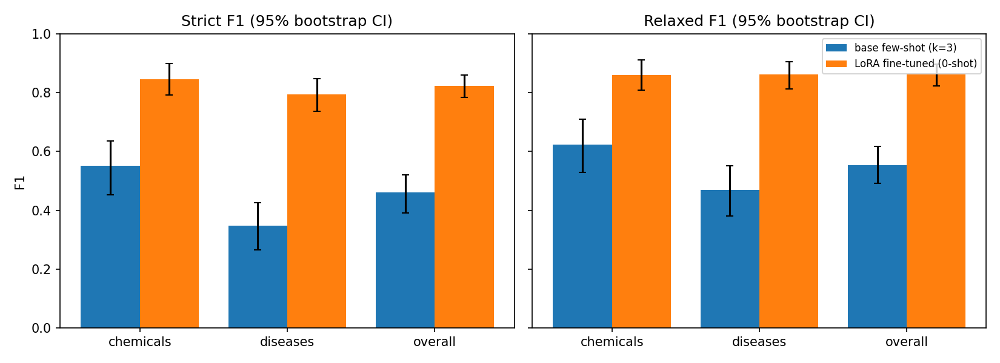
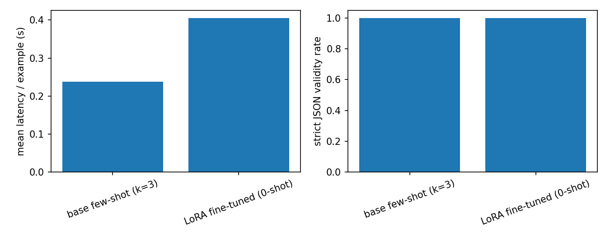

# clinical-lora-extractor

[](https://github.com/rkesseku/clinical-lora-extractor/actions/workflows/ci.yml)
[](https://colab.research.google.com/github/rkesseku/clinical-lora-extractor/blob/main/notebooks/train_and_eval_colab.ipynb)

**LoRA fine-tuning vs. few-shot prompting for structured biomedical entity extraction.**
A small open instruction model is fine-tuned with LoRA to turn a biomedical abstract into JSON
(`{"chemicals": [...], "diseases": [...]}`), then compared, on one shared held-out test set, against
few-shot prompting of the *same* base model and (optionally) a hosted large model. The repo ships a
rigorous evaluation harness (strict/relaxed entity F1, bootstrap CIs, paired significance, JSON
validity, latency, cost) and a FastAPI service that returns schema-validated JSON.

## Motivation

Production extraction systems rarely need the largest model; they need *valid, cheap, predictable*
output. The practical question is whether a 1.5B-parameter model with a few million trainable LoRA
parameters can match or beat prompting (a) the same model few-shot and (b) a much larger hosted model
on a narrow task, and what that costs in latency, tokens and dollars. This project answers that with
proper uncertainty quantification instead of a single point estimate.

> **Data scope.** The corpus is **BC5CDR**: PubMed *abstracts* annotated with chemical and disease
> mentions. It is biomedical **literature**, a public proxy for clinical text. It contains **no PHI** and
> is not clinical-note data; results should not be assumed to transfer to real EHR notes without
> re-validation.

## Architecture

```
            Hugging Face datasets (BC5CDR)
                       |
                 data.py  (spans/BIO -> {"chemicals","diseases"} JSON)
                       |
      +----------------+-----------------+
      |                                  |
 prompts.py                          train.py
 (system + k-shot chat)         (PEFT LoRA, answer-only loss,
      |                          HF Trainer, fp16 / optional 4-bit)
      |                                  |
      +--------> inference.py <----------+      api_baseline.py (optional hosted model)
                 (batched generation,                    |
                  latency/token accounting)              |
                       |                                 |
                 parsing.py  (extract -> strict parse -> repair -> pydantic schema)
                       |
        metrics.py + evaluate.py  -->  results/metrics.json, report.md, plots
                       |
                  serve.py  (FastAPI /extract: parse -> retry -> repair)
```

| Module | Role |
|---|---|
| `src/clinical_lora/data.py` | BC5CDR loading (reads the `tner/bc5cdr` JSON-lines files directly, then its parquet copy, then legacy `bigbio/bc5cdr`; no Hub loading scripts, which `datasets` >= 4 rejects; clear error if none load), span/BIO to JSON conversion |
| `prompts.py` | One instruction template for few-shot prompting and for LoRA training |
| `train.py` | PEFT LoRA + `transformers.Trainer`; loss only on the JSON answer tokens |
| `inference.py` | Batched greedy generation, per-example latency and token counts |
| `parsing.py` | Robust JSON extraction/repair (fences, trailing commas, quotes, truncation) |
| `metrics.py` | Strict/relaxed entity P/R/F1, document-level bootstrap CIs, paired bootstrap |
| `evaluate.py` | Runs all systems through the same scorer; writes JSON, Markdown, plots |
| `api_baseline.py` | Optional hosted-model baseline over plain HTTPS (`ANTHROPIC_API_KEY`) |
| `serve.py` | FastAPI service with pydantic-validated responses and retry/repair |
| `testing.py` | Tiny random model + in-code tokenizer for download-free CPU tests |

## Method

* **Task format.** Input: abstract text. Output: `{"chemicals": [...], "diseases": [...]}` with
  deduplicated mention strings in order of first appearance.
* **Fine-tuning.** LoRA (r=16, alpha=32, dropout 0.05) on all attention and MLP projection layers of
  `Qwen/Qwen2.5-1.5B-Instruct` (Apache-2.0). fp16 on a T4 with fp32 adapter weights; optional 4-bit
  NF4 QLoRA (`load_in_4bit=True`, requires `bitsandbytes`). The prompt tokens are masked out of the
  loss. The core path uses the plain `Trainer`; `trl` is only listed in the `train` extra for those who
  want to swap in `SFTTrainer`.
* **Baselines.** (1) Base model with k-shot demonstrations (default k=3, deterministic selection from
  the train split); (2) optionally a hosted model with the same prompt. The LoRA model is evaluated
  zero-shot because the task lives in the adapter.
* **Same test set for every system.** One deterministic test subsample is shared by all systems; the
  per-document counts are aligned so differences can be tested *paired*.
* **Metrics.** Entity-level, micro-averaged, per type and overall, on mention strings per document:
  * *strict*: exact string match after whitespace normalisation (case-sensitive);
  * *relaxed*: case/punctuation-insensitive, with one-to-one matching that also accepts a token-subset
    overlap (partial-boundary credit, e.g. "hepatic necrosis" vs "necrosis").
  * 95% **percentile bootstrap CIs** by resampling documents; a **paired bootstrap** for the F1
    difference between two systems.
  * **JSON validity**: strict-parse rate (no repair), repaired rate, and parse rate after repair.
    Unparseable output is scored as an empty prediction.
  * **Latency** (amortised per example) and **tokens per example**; **cost** for the API baseline
    only when you supply the per-million-token prices you are billed at (no prices are hard-coded).
* **Caveat.** Because the model outputs strings, not character offsets, this is a string-level
  evaluation, which is more lenient than offset-based BC5CDR benchmarks and not comparable to published
  NER numbers.

## Run on Colab (free T4)

1. Publish this repo to `github.com/rkesseku/clinical-lora-extractor`, then click the **Open in Colab**
   badge above (or open `notebooks/train_and_eval_colab.ipynb`).
2. Select **Runtime > Change runtime type > T4 GPU** and run all cells. Defaults (2,000 training
   documents, 200 test documents, 1 epoch) are chosen to fit in roughly 30-50 minutes; adjust them in the
   config cell.
3. The notebook installs the package from GitHub, trains LoRA, evaluates the few-shot baseline and the
   LoRA model on the same test set, writes `results/` (metrics, report, plots, per-example predictions),
   optionally copies adapter and results to Google Drive, and zips `results/` for download.
4. Optional API baseline: add `ANTHROPIC_API_KEY` under Colab Secrets and fill in the prices.

Command-line equivalent (needs a GPU): `clinical-lora run --n-train 2000 --n-test 200`.

### Is one epoch enough? Training-budget ablation (set up, not yet run)

The reported run used one epoch on 2,000 sentences, a budget choice that was never tested. The
`notebooks/ablation_colab.ipynb` notebook (or `clinical-lora ablate`) trains a grid of
**epochs 1, 2, 3 x 2,000 sentences vs. the full training split**, each from a fresh base model, and
scores every configuration on 300 sentences of the BC5CDR **validation** split. The best configuration
is chosen on validation strict F1 alone; the test set is then used once, for the selected configuration
and for the reported recipe, with a paired bootstrap of the difference. Outputs go to
`results_ablation/` (`ablation.json`, `ablation.md`, `ablation_val_f1.png`). No results are reported
here until it has been run.

The grid is long for one free GPU session, so it saves each finished configuration (validation row
and adapter) and each test evaluation under `results_ablation/checkpoints/` as soon as it completes;
a rerun skips anything already finished with the same settings (`--no-resume` retrains everything).
On Colab, `USE_DRIVE = True` keeps these on Google Drive between sessions. The
`notebooks/ablation_kaggle.ipynb` version runs on a free Kaggle T4 for up to 12 hours as a background
commit, and resumes from an earlier version attached as input.

## Local development (CPU, no downloads)

```bash
pip install torch --index-url https://download.pytorch.org/whl/cpu
pip install -e ".[dev]"
ruff check src tests
pytest
```

The test suite builds a tiny randomly initialised Llama model and a byte-level BPE tokenizer in code,
runs real LoRA training steps, generation, parsing/repair and the full evaluation + report on
synthetic documents, and tests the FastAPI endpoint and API client with stubs. It downloads no model
weights or datasets.

## Serving

```bash
pip install -e ".[serve]"
CLE_BASE_MODEL=Qwen/Qwen2.5-1.5B-Instruct CLE_ADAPTER=adapters/clinical-lora \
  uvicorn clinical_lora.serve:create_app_from_env --factory --port 8000
# or: clinical-lora serve --adapter adapters/clinical-lora [--merge]

curl -s localhost:8000/extract -H 'content-type: application/json' \
  -d '{"text": "Naloxone reverses the antihypertensive effect of clonidine."}'
```

Set `CLE_MERGE=1` (or `--merge`) to merge the adapter into the base weights for serving. The
response is validated against a pydantic schema; if the model emits invalid JSON the service retries
(sampling on retries) and finally falls back to the repair heuristics, returning `502` only when
nothing parseable was produced. Fields `valid_json`, `repaired` and `attempts` expose how the answer
was obtained. `GET /health` reports the loaded model.

## Results

One run on a free Colab **Tesla T4** (fp16 LoRA, no 4-bit), base model `Qwen/Qwen2.5-1.5B-Instruct`,
LoRA r=16 / alpha=32, 1 epoch on **2,000** training examples (training took **4.8 min**, final train
loss 0.090). Both systems are scored on the **same 200 held-out test examples** (seed 0). Examples are
the sentence-level units of the `tner/bc5cdr` release of BC5CDR. Intervals are 95% percentile-bootstrap
CIs over examples (1,000 resamples). Full output: [`docs/results/report.md`](docs/results/report.md),
[`docs/results/metrics.json`](docs/results/metrics.json).

| System | Strict F1 (95% CI) | Relaxed F1 (95% CI) | Strict-JSON rate | Latency / ex, mean (s) | Tokens in / out | Cost / 1k ex |
|---|---|---|---|---|---|---|
| Base model, few-shot (k=3) | 0.460 [0.392, 0.521] | 0.554 [0.492, 0.617] | 1.000 | 0.237 | 381 / 17 | n/a (local) |
| **LoRA fine-tuned (0-shot)** | **0.823 [0.784, 0.861]** | **0.861 [0.823, 0.896]** | 1.000 | 0.406 | 113 / 20 | n/a (local) |

Strict F1 by entity type: chemicals 0.551 to **0.846**, diseases 0.348 to **0.795** (few-shot to LoRA).
The few-shot baseline is precise but misses most entities (strict precision 0.665, recall 0.352); LoRA
lifts recall to 0.790 while also raising precision to 0.859.

**Paired bootstrap, LoRA minus few-shot (overall F1):** strict **+0.362** [+0.308, +0.423], relaxed
**+0.307** [+0.256, +0.359]; two-sided bootstrap p < 0.001 for both (no resample favoured few-shot).

Latency is wall-clock generation time divided by batch size on the same T4 and batch size. The LoRA
model is slower per example despite a 3x shorter prompt, likely because the adapter is applied unmerged
at inference; merging it into the base weights should remove that overhead (not measured here). The
optional hosted-API baseline was not run, so no API cost is reported.




## Limitations

* Literature, not clinical notes; no PHI is involved or implied. Validate on in-domain data before any
  clinical use. This is a research/portfolio project, not a medical device.
* String-level, document-deduplicated evaluation (no offsets, no mention counts).
* The reported run uses a subsample (2,000 train / 200 test examples, one seed) to fit a free T4; scale
  up in the config cell for tighter intervals and repeat over seeds before drawing finer conclusions.
* The training budget (1 epoch, 2,000 sentences) was not tuned; the ablation above tests it but has not
  been run yet.
* Latency is amortised over a generation batch and depends on hardware.

## License

MIT, see `LICENSE`. The base model and dataset carry their own licences (Qwen2.5-1.5B-Instruct:
Apache-2.0; BC5CDR: see the dataset card).
