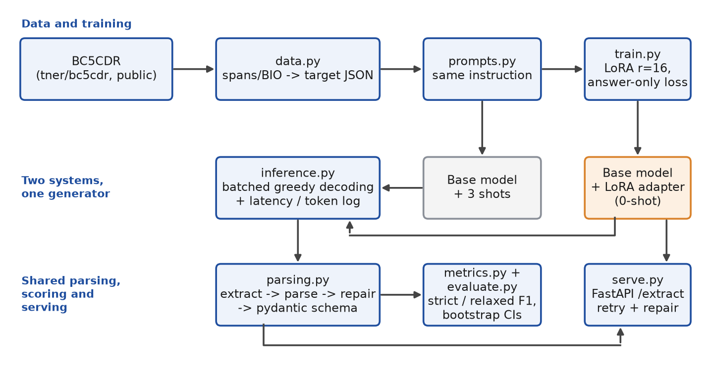
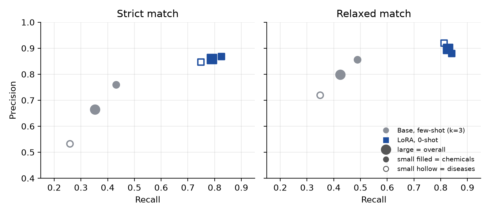
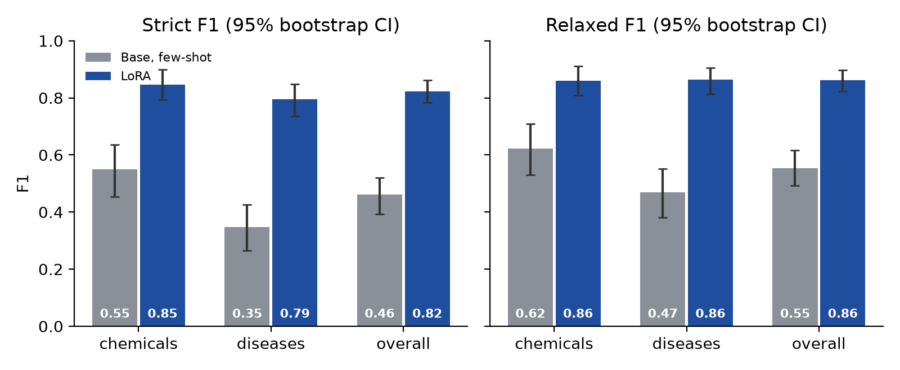
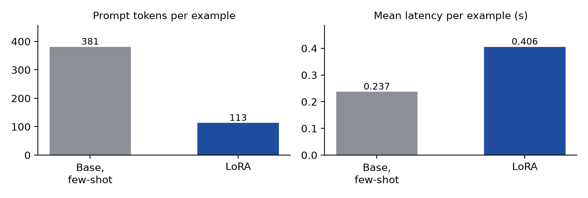

```{=typst}
#set text(hyphenate: false)
#show heading.where(level: 1): it => block(above: 1.2em, below: 0.6em)[
  #set text(fill: rgb("#1f4e9e"), size: 14pt, weight: "bold")
  #it
]
#show heading.where(level: 2): set text(fill: rgb("#2d2d2d"), size: 11.5pt)
#let glance(body) = block(fill: rgb("#eef3fb"), stroke: (left: 3pt + rgb("#1f4e9e")), inset: 10pt, radius: 2pt, width: 100%, body)
```

```{=typst}
#glance[
*At a glance* \
*Problem:* Software that reads biomedical text needs the drugs and diseases it mentions as clean, machine-readable data, not free text. Large hosted models can do this, but a small model that is cheap, private and predictable is often preferable if it is accurate enough. \
*What I built:* A pipeline that fine-tunes a 1.5B-parameter open model (Qwen2.5-1.5B-Instruct) with LoRA to output `{"chemicals": [...], "diseases": [...]}`, an evaluation harness that compares it against few-shot prompting of the same base model on one shared test set, and a FastAPI service that returns schema-validated JSON. \
*Headline result:* On 200 held-out BC5CDR sentences, strict entity F1 rose from *0.460 to 0.823* (paired bootstrap difference +0.362, 95% CI [0.308, 0.423]); training took 4.8 minutes on a free Colab T4. One run, one seed, one dataset (see limitations). \
*Stack:* Python, PyTorch, Hugging Face Transformers + PEFT, pydantic, FastAPI, NumPy, matplotlib, pytest, GitHub Actions. \
*Repo:* #link("https://github.com/rkesseku/clinical-lora-extractor")[github.com/rkesseku/clinical-lora-extractor]
]
```

# The problem

Most clinically relevant information is written as prose. To search it, link it to a database, or feed it to another program, a system first has to pull out the entities that matter, here *chemicals* (drugs and compounds) and *diseases*, and return them in a fixed structure. For example, given "Naloxone reverses the antihypertensive effect of clonidine." (the sentence used in the repo's serving example), the desired output is a JSON object listing `Naloxone` and `clonidine` under `chemicals` and any disease terms under `diseases`.

Beyond accuracy, two properties matter in production. The output must be *valid and predictable*, because downstream code parses it. And it must be *cheap and controllable*: a model small enough to run on one modest GPU can be hosted privately, whereas a large hosted model adds per-token cost and data-sharing questions.

The practical question this project answers is narrow and testable: *for one well-defined extraction task, how much does a small set of trainable LoRA parameters on top of a 1.5B model buy over simply showing the same model three examples in the prompt?* The answer is reported with confidence intervals and a paired significance test rather than a single point estimate.

## What the data is, and is not

The corpus is BC5CDR: PubMed literature annotated with chemical and disease mentions. It is a public *proxy* for clinical text. It contains no protected health information and is not clinical-note data, so the results should not be assumed to transfer to real electronic health record notes without re-validation. The repo says this explicitly, and so does this brief.



# Approach

## Architecture

{#fig-arch width=100%}

## How it works, end to end

1. *Data* (`data.py`). BC5CDR is read from the `tner/bc5cdr` release (JSON-lines files, then a parquet copy, then legacy `bigbio/bc5cdr`), avoiding Hub loading scripts that recent `datasets` versions reject. BIO tags or character spans are converted into the target JSON: deduplicated mention strings per type, in order of first appearance. Examples are the sentence-level units of that release.
2. *Prompt* (`prompts.py`). A single system instruction ("reply with ONLY a JSON object...") and user template are used both for few-shot prompting and for training, so the two systems differ only in how the model learned the task.
3. *Training* (`train.py`). LoRA adapters (r=16, alpha=32, dropout 0.05) on all attention and MLP projection layers; the loss is computed only on the JSON answer tokens plus end-of-sequence, with prompt tokens masked.
4. *Inference* (`inference.py`). Batched greedy decoding with per-example latency and token accounting, identical for both systems.
5. *Parsing* (`parsing.py`). The output passes through candidate extraction (code fences, brace matching), strict JSON parsing, a repair step for trailing commas and truncated output, and finally a pydantic `Extraction` schema. Strictly valid, repaired, and unparseable outputs are tracked separately; unparseable output is scored as an empty prediction.
6. *Evaluation* (`metrics.py`, `evaluate.py`). Strict and relaxed entity-level precision, recall and F1, document-level bootstrap intervals, and a paired bootstrap for the difference between systems. Outputs are `metrics.json`, a Markdown report and plots.
7. *Serving* (`serve.py`). A FastAPI `/extract` endpoint wraps the model in parse, retry and repair logic and returns a validated response with `valid_json`, `repaired` and `attempts` fields so a caller can see how the answer was obtained.



# Methods and design decisions

## Task format and why JSON

The model emits a small fixed schema rather than free text or character offsets. This keeps training targets trivial to generate from BC5CDR annotations and makes validity measurable: either the output parses into the schema or it does not. The trade-off, stated in the README, is that evaluation is string-level, which is more lenient than offset-based NER benchmarks and *not comparable to published BC5CDR NER numbers*.

## Fine-tuning setup

| Setting | Value |
|---|---|
| Base model | Qwen/Qwen2.5-1.5B-Instruct (Apache-2.0) |
| Adapter | LoRA, r=16, alpha=32, dropout 0.05, all attention and MLP projections |
| Precision | fp16 on a Tesla T4, fp32 adapter weights (4-bit QLoRA path exists but was not used) |
| Data | 2,000 training and 200 test examples, seed 0 |
| Optimisation | 1 epoch, learning rate 2e-4, batch 2 with gradient accumulation 8 (effective 16), max length 1024 |
| Outcome | 4.8 minutes of training, final train loss 0.090 |

: Configuration of the reported run, from `metrics.json`. {#tbl-config}

## Design decisions and the reasoning behind them

*Answer-only loss.* Masking the prompt means gradient signal comes only from the JSON the model must produce, and the prompt is truncated from the left rather than the answer, so targets are never cut off.

*The same prompt for both systems.* Using one instruction template removes prompt wording as a confound. The base model gets three deterministic demonstrations (short training sentences containing both entity types, picked at even spacing); the LoRA model is evaluated zero-shot because the task lives in its adapter.

*One shared, deterministic test subsample.* Per-document counts are aligned across systems, which is what makes a *paired* bootstrap valid and gives a much tighter test of the difference than comparing two independent intervals.

*Two match criteria.* Strict is exact string match after whitespace normalisation (case-sensitive). Relaxed is case- and punctuation-insensitive with one-to-one matching that also gives credit for token-subset overlap (for example "hepatic necrosis" against "necrosis"). Reporting both shows how much of the gap is boundary or casing noise versus real misses.

*Validity as a first-class metric.* For a structured-output system, parse rate matters as much as F1. The serving path retries (sampling on retries) and then falls back to repair heuristics, returning HTTP 502 only when nothing parseable was produced.

*No hard-coded prices.* Cost for an optional hosted-model baseline is only computed if the user supplies their own per-token prices, to avoid stale or invented figures.

## Engineering and tests

The test suite has 44 tests (all passing). They build a tiny randomly initialised Llama model and an in-code tokenizer, run real LoRA training steps and generation on CPU, exercise parsing and repair, the metrics, the full evaluation and report on synthetic documents, and the FastAPI endpoint and API client with stubs. No weights or datasets are downloaded, and CI runs on GitHub Actions.



# Results

All numbers come from the single real run in `docs/results/metrics.json` (Colab T4, seed 0): same 200 held-out sentences, 95% percentile-bootstrap CIs (1,000 resamples).

| System | Strict F1 [95% CI] | Relaxed F1 [95% CI] | Strict P / R | Strict-JSON rate |
|---|---|---|---|---|
| Few-shot base (k=3) | 0.460 [0.392, 0.521] | 0.554 [0.492, 0.617] | 0.665 / 0.352 | 1.000 |
| *LoRA (0-shot)* | *0.823 [0.784, 0.861]* | *0.861 [0.823, 0.896]* | 0.859 / 0.790 | 1.000 |

: Overall entity-level results. {#tbl-results}

The paired bootstrap on overall F1 (LoRA minus few-shot) gives *+0.362* [+0.308, +0.423] strict and *+0.307* [+0.256, +0.359] relaxed; no bootstrap resample favoured few-shot (reported two-sided p < 0.001).

{#fig-pr width=56%}

{#fig-f1 width=56%}

*Reading the results.* The few-shot baseline's weakness is recall (0.352 strict overall; diseases 0.258), not precision. LoRA roughly doubles recall (0.790) while also raising precision (0.859). Diseases are the harder type for both systems under strict matching (F1 0.348 to 0.795, against chemicals 0.551 to 0.846), and relaxed matching nearly closes LoRA's chemical/disease gap (0.860 versus 0.863), suggesting some disease error is boundary disagreement. Both systems produced strictly valid JSON for all 200 examples, so the gain is in extraction quality, not format.

*Cost profile.* Prompts average 381 tokens (few-shot) versus 113 (LoRA); mean latency was 0.237 s versus 0.406 s, so LoRA was *slower* despite the shorter prompt.

{#fig-cost width=42%}



# What this demonstrates

- *End-to-end ownership of a fine-tuning project:* data conversion, parameter-efficient training with answer-only loss, batched inference, structured-output parsing, evaluation and serving, in one package with tests and CI.
- *Evaluation discipline:* a shared test set, strict and relaxed metrics, bootstrap intervals, a paired significance test, validity rates and latency, instead of a single headline number.
- *Production thinking about structured output:* schema validation, repair heuristics and retries, with the serving response exposing whether repair was needed.
- *Resource awareness:* the whole experiment trains in under five minutes on a free GPU and the full pipeline runs from a Colab notebook.

# Limitations and next steps

*Limitations (as documented in the repo and checked against the run):*

- *Literature, not clinical notes.* BC5CDR is a proxy; it has no PHI and says nothing directly about EHR text. This is a research and portfolio project, not a medical device.
- *Small, single run.* 2,000 training and 200 test sentence-level examples, one epoch, one seed. The intervals capture test-sample variability only, not training-seed variability, so the size of the gain should be treated as indicative.
- *String-level metric.* Document-deduplicated mention strings, no offsets or mention counts; not comparable to published NER leaderboards.
- *Latency caveat.* The LoRA adapter was evaluated *unmerged*; the likely reason it is slower is adapter overhead at inference. Merging weights (supported via `--merge` in serving) should remove it, but this was *not measured*. Latency is also amortised over a batch and hardware-dependent.
- *No hosted-API comparison.* The optional large-model baseline is implemented but was not run, so no claim is made about how the adapter compares with a larger model, and no cost figures exist.
- No per-example predictions file is committed, so I did not mine individual error cases for this brief.

*Next steps:* repeat over several seeds and more training data for tighter intervals; measure merged-adapter latency; run the hosted-model baseline with real prices; add an offset-based evaluation; and test on real de-identified clinical notes, which is the validation that would actually matter for clinical use.

# How to run it

```
# CPU tests, no downloads
pip install torch --index-url https://download.pytorch.org/whl/cpu
pip install -e ".[dev]"
pytest

# Train + evaluate (needs a GPU; a free Colab T4 is enough)
clinical-lora run --n-train 2000 --n-test 200
#   or open notebooks/train_and_eval_colab.ipynb in Colab

# Serve the adapter
pip install -e ".[serve]"
clinical-lora serve --adapter adapters/clinical-lora [--merge]
curl -s localhost:8000/extract -H 'content-type: application/json' \
  -d '{"text": "Naloxone reverses the antihypertensive effect of clonidine."}'
```

The brief's figures are regenerated from `docs/results/metrics.json` by `docs/brief/make_figures.py`.
